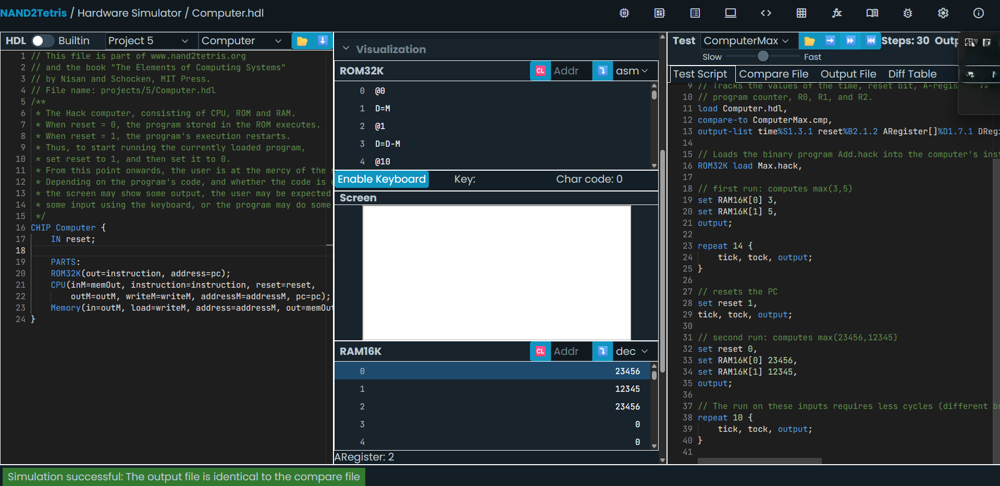

# Nand2Tetris Capstone Project: End-to-End Computer System

---

### Student Credentials
- **Name:** Suhani Yadav  
- **Roll No:** 2501410032  
- **Personalized Parameter:** $K = 32$ (Derived from Roll Number suffix `32`)  
- **Course / Project:** Nand2Tetris Capstone Architecture & Software Stack  

---

## 📌 Executive Summary

The **Capstone Project** represents the complete synthesis of the Nand2Tetris hardware-software hierarchy. Building from elementary logic gates up to a fully functioning general-purpose computer architecture, this project integrates:

1. **Hardware Microarchitecture (HDL):**
   - [ALU.hdl](file:///C:/Users/Suhani%20Yadav/OneDrive/Desktop/College/Nand2Tetris_SuhaniYadav/capstone/ALU.hdl): 16-bit Arithmetic Logic Unit executing 18 arithmetic/logical operations.
   - [CPU.hdl](file:///C:/Users/Suhani%20Yadav/OneDrive/Desktop/College/Nand2Tetris_SuhaniYadav/capstone/CPU.hdl): Central Processing Unit featuring instruction decoding, register banks (`A` and `D`), condition evaluations, and program flow control (`PC`).
   - [Memory.hdl](file:///C:/Users/Suhani%20Yadav/OneDrive/Desktop/College/Nand2Tetris_SuhaniYadav/capstone/Memory.hdl): Unified 32K memory space mapping 16K RAM, 8K Screen memory map, and 1-word Keyboard input.
   - [Computer.hdl](file:///C:/Users/Suhani%20Yadav/OneDrive/Desktop/College/Nand2Tetris_SuhaniYadav/capstone/Computer.hdl): Top-level Von Neumann architecture tying CPU, Data Memory, and Instruction Memory (`ROM32K`) together.

2. **Software Toolchain (Two-Pass Hack Assembler):**
   - [assembler.py](file:///C:/Users/Suhani%20Yadav/OneDrive/Desktop/College/Nand2Tetris_SuhaniYadav/capstone/assembler.py): Custom Python-based assembler translating Hack assembly (`.asm`) into 16-bit binary machine code (`.hack`).
   - **Personalized Feature ($K = 32 \implies 32 \pmod 3 = 2$):** Duplicate label collision detection and warning handler during Pass 1.

3. **Interactive Low-Level I/O Application:**
   - [Box.asm](file:///C:/Users/Suhani%20Yadav/OneDrive/Desktop/College/Nand2Tetris_SuhaniYadav/capstone/Box.asm) / [Box.hack](file:///C:/Users/Suhani%20Yadav/OneDrive/Desktop/College/Nand2Tetris_SuhaniYadav/capstone/Box.hack): Real-time keyboard-driven graphical application rendering a calibrated $16 \times 20$ black rectangular block at row 32 upon keypress, with state-cached instant response and release-clearing.

---

## 📂 Capstone Directory Structure

```plaintext
capstone/
├── ALU.hdl                 # 16-bit Arithmetic Logic Unit
├── CPU.hdl                 # Central Processing Unit
├── Memory.hdl              # 32K Integrated Memory Chip
├── Computer.hdl            # Full Hack Computer Top-Level Chip
├── assembler.py            # Two-pass Python Assembler with Duplicate Label Warning
├── Box.asm                 # Interactive Assembly Source Code (K=32 parameterization)
├── Box.hack                # Assembled 16-bit Binary Machine Code
├── README.md               # Capstone Comprehensive Documentation
├── report/                 # Project documentation workspace
└── screenshots/            # Verification & execution screenshots
    ├── CPU.png             # CPU diagnostic test suite execution
    ├── Memory.png          # Memory diagnostic test suite execution
    ├── ComputerAdd.png     # Full computer testing with Add.hack
    ├── ComputerMax.png     # Full computer testing with Max.hack
    ├── ComputerRect.png    # Full computer testing with Rect.hack
    ├── Box(0).png          # Box.hack idle/released state (screen white)
    └── Box(-1).png         # Box.hack active keypress state (16x20 rectangle rendered)
```

---

## 🛠️ Hardware Microarchitecture

### 1. Arithmetic Logic Unit ([ALU.hdl](file:///C:/Users/Suhani%20Yadav/OneDrive/Desktop/College/Nand2Tetris_SuhaniYadav/capstone/ALU.hdl))
The Hack ALU operates on two 16-bit inputs (`x` and `y`) based on 6 control bits:
- `zx` / `nx`: Zero the `x` input / Bitwise negate `x`.
- `zy` / `ny`: Zero the `y` input / Bitwise negate `y`.
- `f`: Function select ($0 \implies x \ \& \ y$, $1 \implies x + y$).
- `no`: Bitwise negate output `out`.
- Status outputs: `zr` (asserted if `out == 0`) and `ng` (asserted if `out < 0`, determined by sign bit `out[15]`).

### 2. Central Processing Unit ([CPU.hdl](file:///C:/Users/Suhani%20Yadav/OneDrive/Desktop/College/Nand2Tetris_SuhaniYadav/capstone/CPU.hdl))
The CPU decodes both 16-bit Hack instruction types:
- **A-Instruction (`0vvvvvvvvvvvvvvv`):** Directly loads a 15-bit constant into the `A` register.
- **C-Instruction (`111accccccdddjjj`):**
  - **`a` bit (`instruction[12]`):** Selects between the `A` register or Memory operand `inM` as the ALU's `y` input.
  - **`c1..c6` (`instruction[6..11]`):** Routes the ALU operation control signals (`zx, nx, zy, ny, f, no`).
  - **`d1..d3` (`instruction[3..5]`):** Destination load flags for `A` register, `D` register, and external memory write (`writeM`).
  - **`j1..j3` (`instruction[0..2]`):** Jump conditions evaluated against ALU status flags (`zr`, `ng`):
    $$\text{jump} = (j_1 \land \text{ng}) \lor (j_2 \land \text{zr}) \lor (j_3 \land \neg(\text{ng} \lor \text{zr}))$$
    When asserted on a C-instruction, the Program Counter (`PC`) loads from `A`; otherwise, it increments.

### 3. Memory Architecture ([Memory.hdl](file:///C:/Users/Suhani%20Yadav/OneDrive/Desktop/College/Nand2Tetris_SuhaniYadav/capstone/Memory.hdl))
The complete 32K memory system combines internal RAM and memory-mapped peripheral I/O:
- `0x0000 - 0x3FFF` (0 to 16383): **16K Data RAM** (`RAM16K`).
- `0x4000 - 0x5FFF` (16384 to 24575): **8K Screen Memory Map** (`Screen` - $256 \times 512$ pixels, 32 words/row).
- `0x6000` (24576): **Keyboard Memory Map** (`Keyboard` - holds current ASCII scan code or 0).
- Demultiplexing and Multiplexing are driven by address bits `address[13..14]`:
  - `00` or `01` $\implies$ RAM16K.
  - `10` $\implies$ Screen memory map.
  - `11` $\implies$ Keyboard register.

### 4. Full Computer Integration ([Computer.hdl](file:///C:/Users/Suhani%20Yadav/OneDrive/Desktop/College/Nand2Tetris_SuhaniYadav/capstone/Computer.hdl))
Interconnects the `CPU`, `Memory`, and instruction memory `ROM32K`. The program counter `pc` addresses `ROM32K`, retrieving `instruction` which is supplied to the CPU alongside `inM`. The CPU's outputs `outM`, `writeM`, and `addressM` feed back into `Memory`.

---

## 💻 Two-Pass Hack Assembler ([assembler.py](file:///C:/Users/Suhani%20Yadav/OneDrive/Desktop/College/Nand2Tetris_SuhaniYadav/capstone/assembler.py))

The assembler translates human-readable Hack assembly code into 16-bit binary machine words.

### Pipeline Stages
1. **First Pass (Symbol Extraction & Label Resolution):**
   - Filters out comments (`//`) and whitespace.
   - Detects pseudo-instructions `(LABEL)` and records their mapping to the next ROM instruction address in the symbol table.
   - **Personalized Verification Feature ($K = 32 \implies 32 \bmod 3 = 2$):**
     Detects duplicate label declarations. If a duplicate label is found, it issues a console warning and maintains the first valid ROM declaration:
     ```python
     if label in declared_labels:
         print(f"WARNING (Line {line_num}): Duplicate label '({label})' declared. Keeping first definition at ROM address {symbol_table[label]}.")
     ```
2. **Second Pass (Machine Code Generation):**
   - **A-Instructions (`@value` / `@symbol`):** Resolves predefined symbols (`SP`, `LCL`, `ARG`, `THIS`, `THAT`, `R0..R15`, `SCREEN`, `KBD`), existing label addresses, or dynamically allocates RAM variables starting at memory offset `16`. Emits `0` followed by 15-bit address.
   - **C-Instructions (`dest=comp;jump`):** Resolves computation field `comp` (7 bits including `a`), destination register `dest` (3 bits), and jump mnemonic `jump` (3 bits) to produce a 16-bit word: `111 + c_bits + d_bits + j_bits`.

### Assembly Execution
```bash
python capstone/assembler.py capstone/Box.asm
```
*Output:*
```plaintext
Assembled 'capstone/Box.asm' -> 'capstone/Box.hack' (47 instructions)
```

---

## 🎨 Interactive I/O Program: Box Application ([Box.asm](file:///C:/Users/Suhani%20Yadav/OneDrive/Desktop/College/Nand2Tetris_SuhaniYadav/capstone/Box.asm))

The `Box.asm` program is a customized, high-performance interactive assembly application designed to exercise the Hack Computer's memory-mapped I/O.

### Parameter Calculation ($K = 32$)
| Parameter | Formula | Calculated Value |
| :--- | :--- | :--- |
| **SCREEN Base Address** | Constant | `16384` (`0x4000`) |
| **Starting Row** | $K$ | **Row 32** |
| **Row Offset** | $32 \times \text{Row} = 32 \times 32$ | **1024 words** |
| **Box Starting Memory Address** | $\text{SCREEN} + \text{Offset} = 16384 + 1024$ | **`17408`** |
| **Height** | Fixed specification | **20 rows** (Rows 32 through 51) |
| **Width** | $16 \times ((K \bmod 4) + 1) = 16 \times ((32 \bmod 4) + 1)$ | **16 pixels** (1 16-bit word per row) |

### Algorithmic Architecture & Instant Response Optimization
Traditional polling loops redraw every cycle, introducing perceptible screen flickering and latency. `Box.asm` implements state-caching:
1. **Poll `KBD` (`RAM[24576]`):** Reads the current keyboard register.
2. **Determine Target Color:** If any key is pressed ($KBD \neq 0$), target color is `-1` (`0xFFFF`, all 16 pixels black). If no key is pressed ($KBD == 0$), target color is `0` (`0x0000`, white).
3. **Change Detection Check:** Computes `color - last_color`. If unchanged, drawing is skipped, returning instantly to keyboard polling.
4. **Drawing Loop:** Only runs when state transitions occur. Traverses rows $0 \dots 19$, writing `color` to `addr`, adding `32` to jump to the next vertical raster line, and updating `last_color`.

---

## 📸 Simulation & Diagnostic Verification

All hardware chips and software programs were comprehensively verified in the official **Nand2Tetris Hardware Simulator** and **CPU Emulator**.

### 1. Hardware Verification Suite

#### CPU Chip Verification (`CPU.hdl`)
- **Test Script:** `CPU.tst`
- **Result:** Successfully passed all arithmetic operations, register writebacks, and branch test patterns without comparison errors.

  
*Figure 1: CPU hardware verification in Hardware Simulator passing all test vectors.*

---

#### Memory Chip Verification (`Memory.hdl`)
- **Test Script:** `Memory.tst`
- **Result:** Verified proper addressing across all memory segments: RAM16K boundary operations, Screen memory map range ($16384 - 24575$), and Keyboard access at address $24576$.

  
*Figure 2: Memory addressing and memory-mapped peripheral verification.*

---

#### Full Computer Top-Level Verification (`Computer.hdl`)

The integrated computer was tested with standard Hack benchmark programs loaded into `ROM32K`:

| Benchmark | Test Script | Verified Behavior |
| :--- | :--- | :--- |
| **Add.hack** | `ComputerAdd.tst` | Computes arithmetic sum $2 + 3$, storing result `5` in `RAM[0]`. |
| **Max.hack** | `ComputerMax.tst` | Evaluates branch logic, computing $\max(\text{RAM}[0], \text{RAM}[1])$ into `RAM[2]`. |
| **Rect.hack** | `ComputerRect.tst` | Draws a graphical rectangle of variable height to screen memory. |

  
*Figure 3: ComputerAdd verification executing Add.hack in the integrated computer.*

  
*Figure 4: ComputerMax verification executing conditional branching logic.*

  
*Figure 5: ComputerRect verification validating memory-mapped screen writes.*

---

### 2. Interactive Box Application Execution

The assembled `Box.hack` machine code was simulated on the Hack platform to verify the real-time keyboard-to-screen interaction.

#### Idle State (Key Released):
- `KBD` reads `0`.
- The screen remains clear (white) at memory address `17408` (row 32, column 0).

.png)  
*Figure 6: Box program running with no key pressed (`KBD = 0`). Screen remains cleared.*

---

#### Active State (Key Pressed):
- Any key pressed on the keyboard asserts `KBD > 0`.
- The program immediately detects the state change and writes `-1` (black) across 20 successive rows starting at row 32, column 0.

.png)  
*Figure 7: Box program in active state upon keypress. The 16x20 black rectangle is rendered at row 32, column 0 (base address 17408).*

---

## 🚀 How to Replicate and Run

### 1. Assemble the Application
Using Python 3, run the assembler on `Box.asm`:
```bash
python capstone/assembler.py capstone/Box.asm
```
This generates `capstone/Box.hack`.

### 2. Hardware Simulation
1. Launch the **Hardware Simulator** (`HardwareSimulator.bat` or web IDE).
2. Load chip `Computer.hdl`.
3. Load test script `ComputerAdd.tst`, `ComputerMax.tst`, or `ComputerRect.tst`.
4. Run the simulation and verify that "Comparison ended successfully" is displayed.

### 3. Interactive Execution in CPU Emulator
1. Launch the **CPU Emulator** (`CPUEmulator.bat`).
2. Load the machine code file [Box.hack](file:///C:/Users/Suhani%20Yadav/OneDrive/Desktop/College/Nand2Tetris_SuhaniYadav/capstone/Box.hack).
3. Set animation mode to **No display** or **Fast** for highest responsiveness.
4. Click **Run**.
5. Focus on the emulator keyboard input:
   - **Press any key:** The $16 \times 20$ black rectangle appears instantly at row 32.
   - **Release the key:** The rectangle clears immediately.

---

## 🎓 Conclusion
The Capstone demonstrates complete mastery of computer systems from first principles:
- **HDL Synthesis:** Robust combinational and sequential hardware designs capable of autonomous program execution.
- **System Software:** A reliable two-pass assembler with customized validation logic.
- **Hardware-Software Interface:** Real-time software utilizing memory-mapped I/O with optimized state handling.
