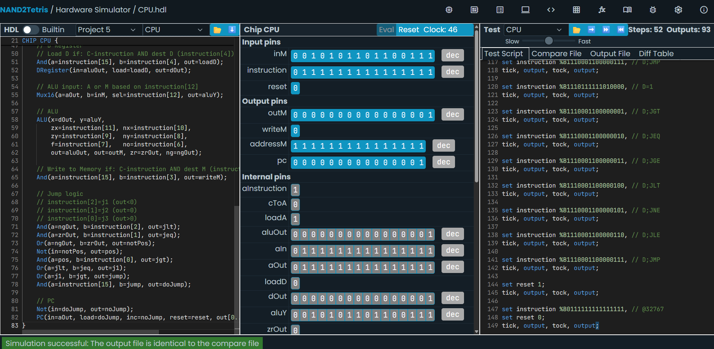
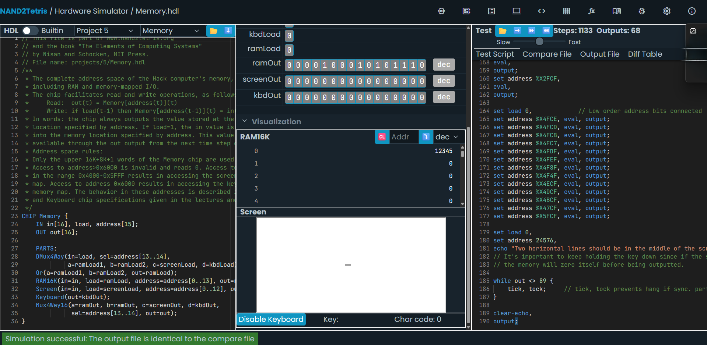

# Capstone Project -  Make the Computer Draw a Box

---

### Student Information
- **Name:** Suhani Yadav  
- **Roll No:** 2501410032  
- **Personalized Parameter:** $K = 32$ (Roll Number suffix `32`)  

---

## Executive Summary

The **Nand2Tetris Capstone** marks the complete integration of the hardware and software layers of the Hack computer system. Starting from fundamental combinational and sequential gates, this capstone delivers:

1. **Hardware Microarchitecture (HDL):** A fully functional Von Neumann computer comprising a 16-bit ALU, general-purpose CPU, a 32K unified memory space, and the top-level Computer integration.
2. **Software Translation (Assembler):** A two-pass Python assembler (`assembler.py`) supporting symbol resolution and a personalized duplicate label detection mechanism ($32 \bmod 3 = 2$).
3. **Low-Level Interactive Application:** An optimized assembly program (`Box.asm`) performing real-time memory-mapped I/O, rendering a calibrated $16 \times 20$ black box at row 32 upon keyboard input.

---

## File Structure

| File | Type | Description |
| :--- | :--- | :--- |
| [ALU.hdl](file:///C:/Users/Suhani%20Yadav/OneDrive/Desktop/College/Nand2Tetris_SuhaniYadav/capstone/ALU.hdl) | HDL | 16-bit Arithmetic Logic Unit executing 18 operations with `zr` and `ng` flags |
| [CPU.hdl](file:///C:/Users/Suhani%20Yadav/OneDrive/Desktop/College/Nand2Tetris_SuhaniYadav/capstone/CPU.hdl) | HDL | Central Processing Unit with A/D registers, decoder, ALU, and PC branching |
| [Memory.hdl](file:///C:/Users/Suhani%20Yadav/OneDrive/Desktop/College/Nand2Tetris_SuhaniYadav/capstone/Memory.hdl) | HDL | Unified 32K memory mapping 16K RAM, 8K Screen map, and 1-word Keyboard |
| [Computer.hdl](file:///C:/Users/Suhani%20Yadav/OneDrive/Desktop/College/Nand2Tetris_SuhaniYadav/capstone/Computer.hdl) | HDL | Top-level architecture integrating `ROM32K`, `CPU`, and `Memory` |
| [assembler.py](file:///C:/Users/Suhani%20Yadav/OneDrive/Desktop/College/Nand2Tetris_SuhaniYadav/capstone/assembler.py) | Python | Two-pass Hack assembler featuring personalized duplicate label detection |
| [Box.asm](file:///C:/Users/Suhani%20Yadav/OneDrive/Desktop/College/Nand2Tetris_SuhaniYadav/capstone/Box.asm) | Assembly | Interactive graphics program customized for $K = 32$ |
| [Box.hack](file:///C:/Users/Suhani%20Yadav/OneDrive/Desktop/College/Nand2Tetris_SuhaniYadav/capstone/Box.hack) | Binary | 16-bit machine code generated by `assembler.py` (47 instructions) |
| `screenshots/` | Assets | Hardware simulator and CPU emulator verification test runs |

---

## Hardware Architecture & Implementation

```plaintext
                   +---------------------------------------+
                   |               Computer                |
                   |                                       |
                   |   +----------+        +-----------+   |
      reset ------>|-->|   CPU    |------->|  Memory   |   |
                   |   |          | outM   |  (RAM16K, |   |
                   |   |          | writeM |  Screen,  |   |
                   |   |          | addrM  |  Keyboard)|   |
                   |   +----------+        +-----------+   |
                   |     ^      | pc             |         |
                   |     |      v                v         |
                   |   +----------+             inM        |
                   |   |  ROM32K  |------------------------+
                   |   +----------+ instruction
                   +---------------------------------------+
```

### 1. Arithmetic Logic Unit ([ALU.hdl](file:///C:/Users/Suhani%20Yadav/OneDrive/Desktop/College/Nand2Tetris_SuhaniYadav/capstone/ALU.hdl))
Computes arithmetic and bitwise logical functions across two 16-bit registers (`x`, `y`):
- **Inputs:** 16-bit `x`, 16-bit `y`, and 6 control bits: `zx, nx, zy, ny, f, no`.
- **Status Flags:**
  - `zr`: Output is zero (`out == 0`).
  - `ng`: Output is negative (`out < 0`, reading `out[15]`).

### 2. Central Processing Unit ([CPU.hdl](file:///C:/Users/Suhani%20Yadav/OneDrive/Desktop/College/Nand2Tetris_SuhaniYadav/capstone/CPU.hdl))
Executes the Hack instruction set architecture:
- **Instruction Parsing:**
  - **A-instruction (`0vvv...`):** Loads 15-bit address constant directly into the `A` register.
  - **C-instruction (`111accccccdddjjj`):** Decodes ALU input select (`a`), ALU function controls (`c1..c6`), destination registers (`d1..d3` for $A$, $D$, and Memory $M$), and jump conditions (`j1..j3`).
- **Jump Logic:** Evaluates branch flags against ALU outputs `zr` and `ng`:
  $$\text{jump} = (j_1 \land \text{ng}) \lor (j_2 \land \text{zr}) \lor (j_3 \land \neg(\text{ng} \lor \text{zr}))$$
  When a jump is taken on a C-instruction, the Program Counter (`PC`) loads from the `A` register; otherwise, it increments sequentially.

### 3. Integrated Memory Space ([Memory.hdl](file:///C:/Users/Suhani%20Yadav/OneDrive/Desktop/College/Nand2Tetris_SuhaniYadav/capstone/Memory.hdl))
Implements a 32K continuous address space through high-order bit decoding (`address[13..14]`):

| Address Range (Hex) | Address Range (Dec) | Size | Target Hardware Unit |
| :--- | :--- | :--- | :--- |
| `0x0000 - 0x3FFF` | `0 - 16383` | 16K words | **Data RAM** (`RAM16K`) |
| `0x4000 - 0x5FFF` | `16384 - 24575` | 8K words | **Screen Memory Map** ($256 \times 512$ pixels, 32 words/row) |
| `0x6000` | `24576` | 1 word | **Keyboard Memory Map** (`KBD` scan code) |

---

## Two-Pass Hack Assembler ([assembler.py](file:///C:/Users/Suhani%20Yadav/OneDrive/Desktop/College/Nand2Tetris_SuhaniYadav/capstone/assembler.py))

A Python translation toolchain converting Hack assembly into 16-bit binary machine code.

- **Pass 1 (Symbol Table & Label Extraction):**
  - Scans line-by-line, strips comments (`//`) and whitespace.
  - Resolves label pseudo-instructions `(LABEL)` to the subsequent ROM instruction address.
  - **Personalized Feature ($K = 32 \implies 32 \bmod 3 = 2$):**
    Detects duplicate label declarations, prints a warning message indicating the line number, and preserves the initial ROM address definition.
- **Pass 2 (Binary Code Generation):**
  - Converts `@symbol` / `@value` to 16-bit A-instructions, dynamically allocating variables starting at `RAM[16]`.
  - Converts `dest=comp;jump` mnemonics to binary C-instructions using bitfield lookups:
    $$\text{Instruction} = \mathbf{111} \parallel \text{comp}[7] \parallel \text{dest}[3] \parallel \text{jump}[3]$$
  - Produces the executable `.hack` binary file.

---

## Interactive Box Program ([Box.asm](file:///C:/Users/Suhani%20Yadav/OneDrive/Desktop/College/Nand2Tetris_SuhaniYadav/capstone/Box.asm))

A low-level assembly application demonstrating memory-mapped I/O interaction between the keyboard and the display screen.

### Calibration Parameters ($K = 32$)

| Parameter | Formula | Calculated Value |
| :--- | :--- | :--- |
| **SCREEN Base Address** | Constant | `16384` (`0x4000`) |
| **Target Starting Row** | $K$ | **Row 32** |
| **Row Offset** | $32 \times \text{Row} = 32 \times 32$ | **1024 words** |
| **Start Memory Address** | $\text{SCREEN} + \text{Offset} = 16384 + 1024$ | **`17408`** |
| **Height** | Fixed specification | **20 rows** (Rows 32 through 51) |
| **Width** | $16 \times ((32 \bmod 4) + 1) = 16 \times 1$ | **16 pixels** (1 word per row) |

### State-Tracking Optimization
- **Continuous Polling:** Reads scan codes from the keyboard memory map (`RAM[24576]`).
- **Instant Response Logic:**
  - Key pressed ($KBD \neq 0$) $\implies$ Target color = `-1` (`0xFFFF`, 16 black pixels).
  - Key released ($KBD == 0$) $\implies$ Target color = `0` (`0x0000`, white).
- **Differential Update:** Compares `color` with `last_color`. If unchanged, the drawing loop is bypassed entirely. The 20-row drawing routine runs only on state transitions, providing immediate response without screen tearing.

---

## Verification & Screenshots

### 1. Interactive Program Execution (`Box.hack`) - Main Capstone Demonstration

The interactive application demonstrates real-time hardware-software co-design via memory-mapped I/O on the CPU Emulator.

#### Idle State (Key Released)
When no key is pressed (`KBD = 0`), the screen remains clear (white) at memory address `17408` (row 32, column 0).  
Reference file: [Box(0).png](file:///C:/Users/Suhani%20Yadav/OneDrive/Desktop/College/Nand2Tetris_SuhaniYadav/capstone/screenshots/Box(0).png)

[.png>)](<screenshots/Box(0).png>)

---

#### Active State (Key Pressed)
When any key is pressed (`KBD > 0`), the application immediately renders the $16 \times 20$ black rectangular block starting at row 32, column 0 (base address `17408`).  
Reference file: [Box(-1).png](file:///C:/Users/Suhani%20Yadav/OneDrive/Desktop/College/Nand2Tetris_SuhaniYadav/capstone/screenshots/Box(-1).png)

[.png>)](<screenshots/Box(-1).png>)

---

### 2. Hardware Verification (Hardware Simulator)

#### CPU Chip Verification (`CPU.hdl`)
Verified arithmetic operations, register writeback, and conditional branching logic using `CPU.tst`.  
Reference file: [CPU.png](file:///C:/Users/Suhani%20Yadav/OneDrive/Desktop/College/Nand2Tetris_SuhaniYadav/capstone/screenshots/CPU.png)

[](<screenshots/CPU.png>)

---

#### Memory System Verification (`Memory.hdl`)
Verified addressing across RAM16K (`0 - 16383`), Screen memory map (`16384 - 24575`), and Keyboard register (`24576`) using `Memory.tst`.  
Reference file: [Memory.png](file:///C:/Users/Suhani%20Yadav/OneDrive/Desktop/College/Nand2Tetris_SuhaniYadav/capstone/screenshots/Memory.png)

[](<screenshots/Memory.png>)

---

### 3. Integrated Computer Execution (`Computer.hdl`)

The top-level computer architecture was verified using standard Hack benchmark suites in the Hardware Simulator.

#### Add Benchmark (`Add.hack`)
Computes the arithmetic sum $2 + 3 = 5$, verifying data memory write to `RAM[0]`.  
Reference file: [ComputerAdd.png](file:///C:/Users/Suhani%20Yadav/OneDrive/Desktop/College/Nand2Tetris_SuhaniYadav/capstone/screenshots/ComputerAdd.png)

[](<screenshots/ComputerAdd.png>)

---

#### Max Benchmark (`Max.hack`)
Evaluates branch conditions, computing $\max(\text{RAM}[0], \text{RAM}[1])$ into `RAM[2]`.  
Reference file: [ComputerMax.png](file:///C:/Users/Suhani%20Yadav/OneDrive/Desktop/College/Nand2Tetris_SuhaniYadav/capstone/screenshots/ComputerMax.png)

[](<screenshots/ComputerMax.png>)

---

#### Rect Benchmark (`Rect.hack`)
Draws a rectangle of variable height to screen memory, validating memory-mapped screen writes.  
Reference file: [ComputerRect.png](file:///C:/Users/Suhani%20Yadav/OneDrive/Desktop/College/Nand2Tetris_SuhaniYadav/capstone/screenshots/ComputerRect.png)

[](<screenshots/ComputerRect.png>)

---

## How to Run

1. **Assemble the Assembly Code:**
   ```bash
   python capstone/assembler.py capstone/Box.asm
   ```
2. **Simulate Hardware Chips:**
   - Launch the **Hardware Simulator**, load `Computer.hdl`.
   - Run verification test scripts: `ComputerAdd.tst`, `ComputerMax.tst`, or `ComputerRect.tst`.
3. **Run Application in CPU Emulator:**
   - Launch the **CPU Emulator**, load [Box.hack](file:///C:/Users/Suhani%20Yadav/OneDrive/Desktop/College/Nand2Tetris_SuhaniYadav/capstone/Box.hack).
   - Set simulation speed to **Fast** and click **Run**.
   - Press any key to display the box; release to clear.
