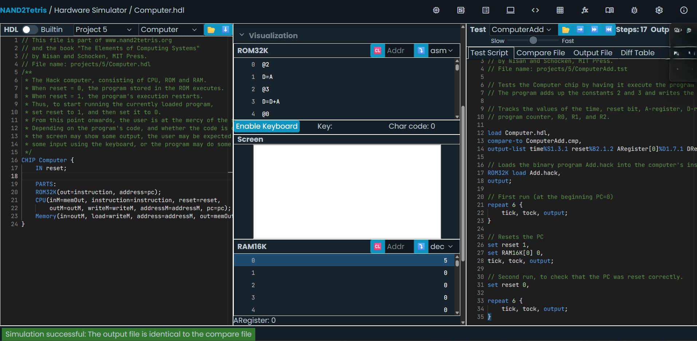
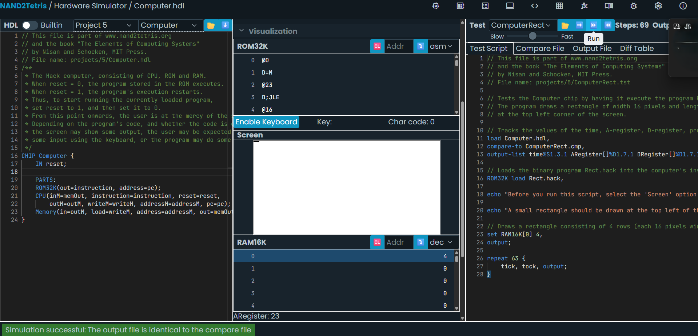

# Nand2Tetris Capstone Project

**Name:** Suhani Yadav  
**Roll No:** 2501410032  
**Parameter ($K$):** 32 (Roll No suffix)  

---

## 📌 Overview

This Capstone project implements a complete, working computer system from logic gates to assembly software:
1. **Hardware (HDL):** 16-bit ALU, CPU, 32K Memory, and complete Hack Computer.
2. **Software (Assembler):** Two-pass Python assembler with duplicate label warning ($32 \bmod 3 = 2$).
3. **I/O Program (Assembly):** Real-time interactive program rendering a $16 \times 20$ box upon keypress.

---

## 📂 File Structure

| File | Description |
| :--- | :--- |
| [ALU.hdl](file:///C:/Users/Suhani%20Yadav/OneDrive/Desktop/College/Nand2Tetris_SuhaniYadav/capstone/ALU.hdl) | 16-bit Arithmetic Logic Unit (18 operations, `zr`, `ng` flags) |
| [CPU.hdl](file:///C:/Users/Suhani%20Yadav/OneDrive/Desktop/College/Nand2Tetris_SuhaniYadav/capstone/CPU.hdl) | Central Processing Unit (decodes A/C instructions, PC control) |
| [Memory.hdl](file:///C:/Users/Suhani%20Yadav/OneDrive/Desktop/College/Nand2Tetris_SuhaniYadav/capstone/Memory.hdl) | 32K address space: RAM16K, Screen map (8K), Keyboard (1 word) |
| [Computer.hdl](file:///C:/Users/Suhani%20Yadav/OneDrive/Desktop/College/Nand2Tetris_SuhaniYadav/capstone/Computer.hdl) | Top-level architecture (ROM32K + CPU + Memory) |
| [assembler.py](file:///C:/Users/Suhani%20Yadav/OneDrive/Desktop/College/Nand2Tetris_SuhaniYadav/capstone/assembler.py) | Two-pass Assembler (`.asm` $\to$ `.hack`) with duplicate label warning |
| [Box.asm](file:///C:/Users/Suhani%20Yadav/OneDrive/Desktop/College/Nand2Tetris_SuhaniYadav/capstone/Box.asm) | Interactive Hack assembly program (calibrated for $K=32$) |
| [Box.hack](file:///C:/Users/Suhani%20Yadav/OneDrive/Desktop/College/Nand2Tetris_SuhaniYadav/capstone/Box.hack) | 16-bit machine code (47 instructions) |
| `screenshots/` | Verification & test run outputs |

---

## ⚙️ Key Specifications & Calculations

### 1. Interactive Box Program ($K = 32$)
- **Screen Base:** $16384$ (`0x4000`)
- **Starting Row:** $K = 32 \implies \text{Offset} = 32 \times 32 = 1024$ words
- **Start Address:** $16384 + 1024 = \mathbf{17408}$
- **Height:** 20 rows (rows 32 to 51)
- **Width:** $16 \times ((32 \bmod 4) + 1) = \mathbf{16\text{ pixels}}$ (1 word/row)
- **Behavior:** Polls `KBD` (`RAM[24576]`). Draws black rectangle (`-1`) on keypress; clears to white (`0`) on release. Uses state-caching (`last_color`) to eliminate lag and flicker.

### 2. Assembler Custom Feature
- **Rule:** $K \bmod 3 = 32 \bmod 3 = \mathbf{2}$ $\implies$ **Duplicate Label Warning**.
- **Pass 1:** Builds symbol table and issues a warning if a label is declared multiple times.
- **Pass 2:** Translates instructions into 16-bit binary code and allocates variables starting at `RAM[16]`.

---

## 📸 Verification & Screenshots

### 1. Hardware Verification (Hardware Simulator)

#### CPU (`CPU.hdl`)
Verified arithmetic operations, register writeback, and branching conditions.


#### Memory (`Memory.hdl`)
Verified RAM16K, Screen map ($16384-24575$), and Keyboard register ($24576$).


#### Computer Integration (`Computer.hdl`)

| Add Test (`Add.hack`) | Max Test (`Max.hack`) | Rect Test (`Rect.hack`) |
| :---: | :---: | :---: |
|  |  |  |
| *Computes $2+3=5$ into RAM[0]* | *Branch logic max(R0, R1)* | *Draws rectangle to screen* |

---

### 2. Interactive Program Execution (`Box.hack`)

| Key Released (Idle State) | Key Pressed (Active State) |
| :---: | :---: |
| .png) | .png) |
| *KBD = 0: Screen remains white* | *KBD > 0: $16 \times 20$ black box rendered at row 32* |

---

## 🚀 How to Run

1. **Assemble Assembly Code:**
   ```bash
   python capstone/assembler.py capstone/Box.asm
   ```
2. **Test Hardware Chips:**
   - Open **Hardware Simulator**, load `Computer.hdl` and run `ComputerAdd.tst`, `ComputerMax.tst`, or `ComputerRect.tst`.
3. **Run Interactive Application:**
   - Open **CPU Emulator**, load [Box.hack](file:///C:/Users/Suhani%20Yadav/OneDrive/Desktop/College/Nand2Tetris_SuhaniYadav/capstone/Box.hack).
   - Set speed to **Fast** and click **Run**. Press any key to draw the box; release to clear.
